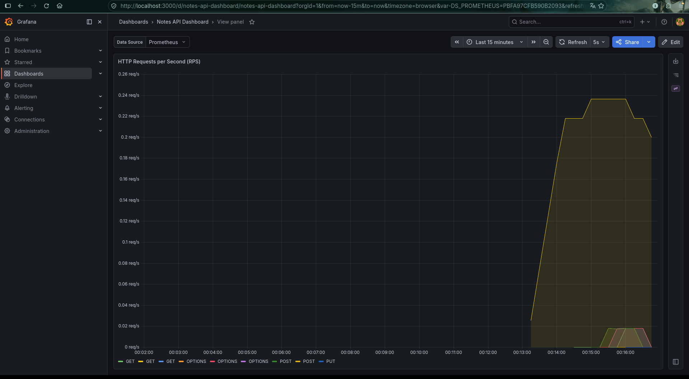

```markdown
# Notes API

[](https://github.com/ImmortaL-jsdev/notes-api/actions/workflows/ci.yml)

**🔗 Живая демонстрация (Health Check):** [https://notes-api-immortal-backdev.mia0.amvera.tech/health](https://notes-api-immortal-backdev.mia0.amvera.tech/health)

REST API для управления заметками с JWT-аутентификацией, асинхронным экспортом задач (Redis + Worker) и мониторингом (Prometheus + Grafana). Построен на Go с использованием чистой архитектуры (handler → service → repository).

## 🚀 Ключевые особенности

- **JWT-аутентификация:** Access и Refresh токены.
- **Изоляция данных:** Пользователи имеют доступ только к своим заметкам (защита через middleware и Foreign Keys).
- **Асинхронный экспорт:** Тяжелые операции (генерация файлов) вынесены в фоновый воркер. Используется Redis в качестве очереди, реализованы механизмы Retry и Dead Letter Queue (DLQ).
- **Мониторинг:** Сбор метрик через Prometheus и готовый дашборд для Grafana.
- **Тестирование:** Покрытие юнит-тестами (gomock) и интеграционными тестами (testcontainers).
- **CI/CD:** GitHub Actions (линтер, тесты, зеркалирование в GitLab).
- **Frontend:** Простой HTML/JS клиент для ручного тестирования API в папке `frontend/` (уже настроен на работу с живым API).

## 🛠 Стек технологий

- **Go 1.25+**
- **PostgreSQL** — основная база данных (драйвер `pgx/v5`).
- **Redis** — брокер сообщений для очереди экспорта.
- **JWT** (`golang-jwt/jwt/v5`) + **bcrypt** — безопасность.
- **Gorilla Mux** — HTTP-роутинг.
- **Docker / docker-compose** — локальное окружение.
- **Prometheus + Grafana** — мониторинг и визуализация.
- **Testcontainers** — интеграционные тесты с реальной БД.

## ⚡️ Быстрый старт (локально)

1. Клонируйте репозиторий:
   ```bash
   git clone https://github.com/ImmortaL-jsdev/notes-api.git
   cd notes-api
   ```

2. Запустите инфраструктуру (Postgres, Redis, Prometheus, Grafana):
   ```bash
   docker compose up -d
   ```

3. Примените миграции к базе данных:
   ```bash
   docker compose exec -T postgres psql -U notes_user -d notes_db < migrations/000001_create_notes_table.up.sql
   docker compose exec -T postgres psql -U notes_user -d notes_db < migrations/000002_create_users.up.sql
   docker compose exec -T postgres psql -U notes_user -d notes_db < migrations/000003_add_user_id_to_notes.up.sql
   ```

4. Запустите сервер (и фоновый воркер):
   ```bash
   go run cmd/server/main.go
   ```
   Сервер будет доступен на `http://localhost:8080`.

## ⚙️ Переменные окружения

Для локального запуска все переменные имеют дефолтные значения. Для продакшена (как на Amvera) их необходимо переопределить.

| Переменная | Описание | По умолчанию |
|------------|----------|--------------|
| `DB_HOST` | Хост PostgreSQL | `localhost` |
| `DB_PORT` | Порт PostgreSQL | `5432` |
| `DB_USER` | Пользователь БД | `notes_user` |
| `DB_PASSWORD` | Пароль БД | `notes_pass` |
| `DB_NAME` | Имя базы данных | `notes_db` |
| `JWT_SECRET` | Секретный ключ для подписи токенов | `supersecret` |
| `REDIS_ADDR` | Адрес Redis | `localhost:6379` |
| `PORT` | Порт HTTP-сервера | `8080` |

## 📡 API Endpoints

### Публичные (без токена)
- `POST /api/register` — Регистрация `{"email": "...", "password": "..."}`
- `POST /api/login` — Авторизация, возвращает `{"access_token": "...", "refresh_token": "..."}`
- `GET /health` — Проверка статуса сервера
- `GET /metrics` — Метрики Prometheus

### Защищенные (требуют заголовок `Authorization: Bearer <access_token>`)
- `GET /notes` — Получить все свои заметки
- `POST /notes` — Создать заметку `{"title": "...", "content": "..."}`
- `GET /notes/{id}` — Получить заметку по ID
- `PUT /notes/{id}` — Обновить заметку
- `DELETE /notes/{id}` — Удалить заметку
- `POST /notes/bulk` — Массовое создание заметок
- `POST /notes/export` — Запустить асинхронный экспорт заметок в файл (результат в папке `exports/`)

## 📊 Мониторинг

В проекте настроен автоматический провижининг (Infrastructure as Code) для Prometheus и Grafana. 

После запуска `docker compose up -d`, откройте Grafana по адресу `http://localhost:3000` (логин/пароль: `admin`/`admin`). В разделе **Dashboards** вас встретит готовый дашборд с графиками RPS, задержек (p95 latency) и метриками работы фонового воркера.



## 🧪 Тестирование

```bash
# Юнит-тесты сервиса (с моками)
make test-unit

# Интеграционные тесты репозитория (testcontainers)
make test-integration

# Линтер
make lint
```

## 🏗 Архитектура запуска приложения

При запуске сервера происходят следующие этапы:
1. **Инициализация:** Считывание ENV-переменных, подключение к Redis и PostgreSQL.
2. **Фоновые процессы:** Запуск горутины `StartExportWorker` для обработки тяжелых задач экспорта.
3. **Роутинг:** Настройка роутера Gorilla Mux.
   - Глобальное middleware сбора метрик Prometheus (`MetricsMiddleware`).
   - Разделение на публичные маршруты и приватный субмаршрутизатор `/notes` под защитой `AuthMiddleware`.
4. **Graceful Shutdown:** Перехват системных сигналов `SIGINT`/`SIGTERM` для плавного завершения работы за 30 секунд.

## 💻 Клиентское приложение

В папке `frontend/` находится простой HTML-интерфейс для тестирования API.  
Откройте `index.html` в браузере, чтобы взаимодействовать с сервером без использования `curl`.  
Клиент уже настроен на работу с живым API в облаке, но вы также можете изменить константу `BASE` в коде на `http://localhost:8080` для локальной разработки.

## 📁 Структура проекта

```
notes-api/
├── cmd/server/            # Точка входа (main.go), сборка зависимостей, graceful shutdown
├── internal/
│   ├── auth/              # Генерация и валидация JWT
│   ├── errors/            # Кастомные ошибки (ValidationError, NotFoundError)
│   ├── handlers/          # HTTP-обработчики
│   ├── middleware/        # JWT-авторизация, метрики, логирование, CORS
│   ├── models/            # Структуры данных (Note, User, TokenPair)
│   ├── redis/             # Клиент Redis
│   ├── repository/        # Работа с PostgreSQL (pgx)
│   ├── service/           # Бизнес-логика и валидация
│   └── worker/            # Фоновый воркер экспорта (Redis BRPOP, Retry, DLQ)
├── migrations/            # SQL-миграции
├── prometheus/            # Конфигурация сбора метрик
├── grafana/               # Provisioning дашбордов и datasources
├── frontend/              # HTML/JS клиент для тестирования
├── docker-compose.yml     # Инфраструктура для локальной разработки
└── .github/workflows/     # CI/CD пайплайны
```

## Лицензия

MIT
```